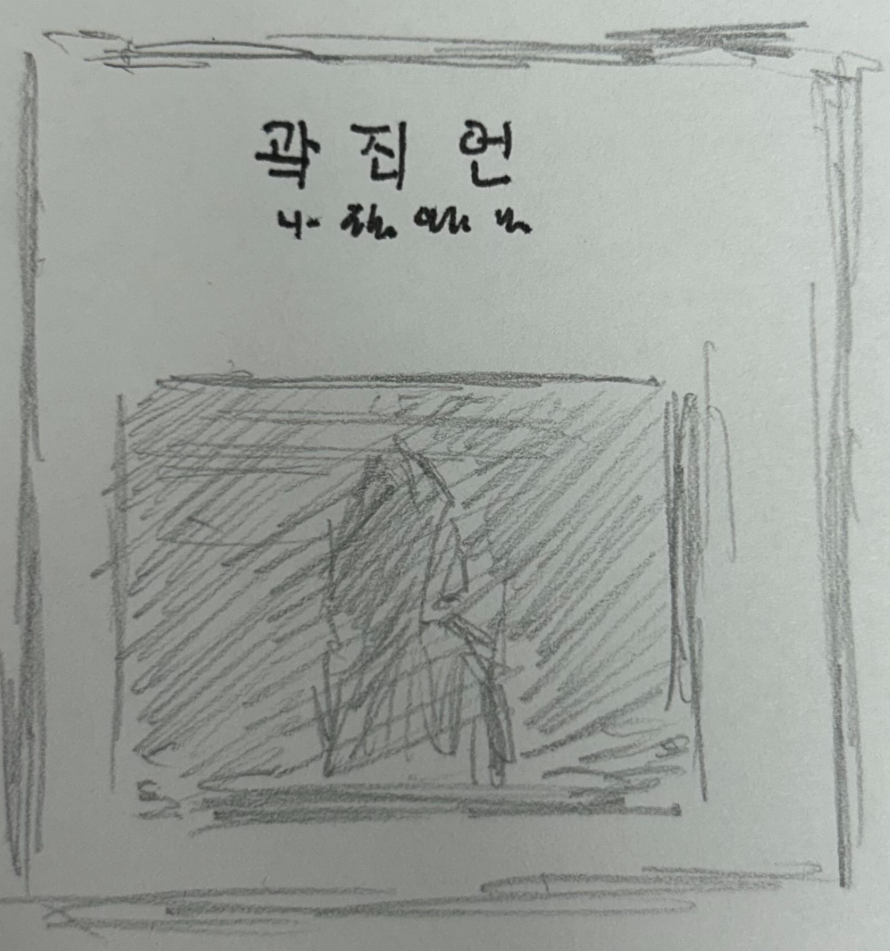

  
  

    

      推薦 Kwak Jin Eon 的 Boast
       
      出自專輯 Go with me
       
      <a href="https://open.spotify.com/track/199onUPWOhg4hkqGLAZ3z3?si=7a991603d64345a1" target="_blank">收聽連結 -> 點此前往</a>
    

  

  

    
  

<!-- more -->
轉載自個人ig每日點播> chjuhsu05
 
我覺得想念不是只能是過去發生的溫暖，回望這個動作出現之後才發生。想念未必也都指向已經失去的人。這首炫耀（歌名翻譯）給了我很特別的體驗，呢喃的表現方式讓整首歌的聽感很特別，在概念表現上，這首留下了一個想念的另外一個期待：希望自己有一天幸福到能夠分享愛，而那一天，最想先告訴你。

註：ai幫忙總結說：因為遇見你，我才發現自己原來也有脆弱的一面，才有後面的炫耀。但建議可以將歌名理解成「想第一個向你分享的驕傲」。

非常推薦啊啊啊
