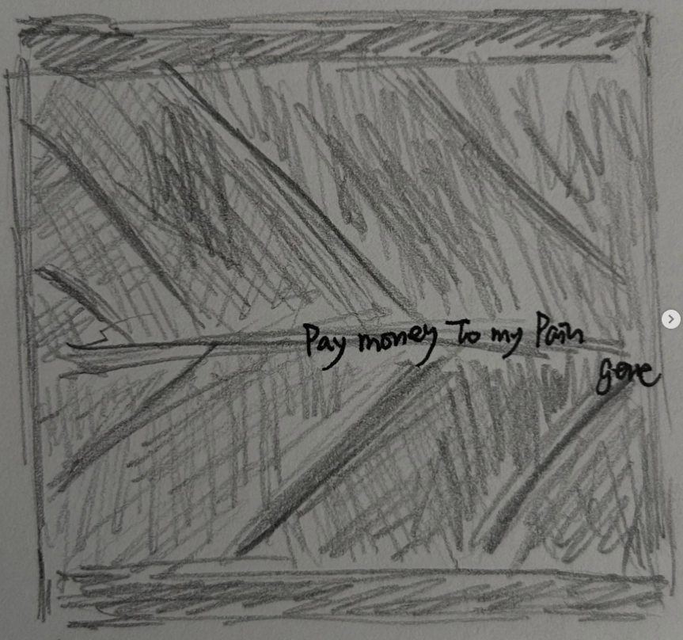

  

    

      推薦 Pay money to my pain 的 Rain
       
      出自專輯 gene
       
      <a href="https://open.spotify.com/track/5LXh3ZNhWUwfX30YZc6VO4?si=edc6d5e22a2a44f9" target="_blank">收聽連結 -> 點此前往</a>
    

  

  

    
  

<!-- more -->
轉載自個人ig每日點播> chjuhsu05
 
這首歌有一種很特別的電影感，彷彿能隨著音樂想像出一幕幕畫面，大雨之中面對失去，面對自己的脆弱，試著克服困境，保留著掙扎與未解決的情感尋找答案

(尤其喜歡這首歌對聲音的呈現。除了旋律與編曲的推進非常流暢，人聲的音色與空間感也很特別，聽起來彷彿經過一些刻意的聲音處理，讓整首歌多了一種置身電影場景的感覺。)

非常推薦啊啊啊
