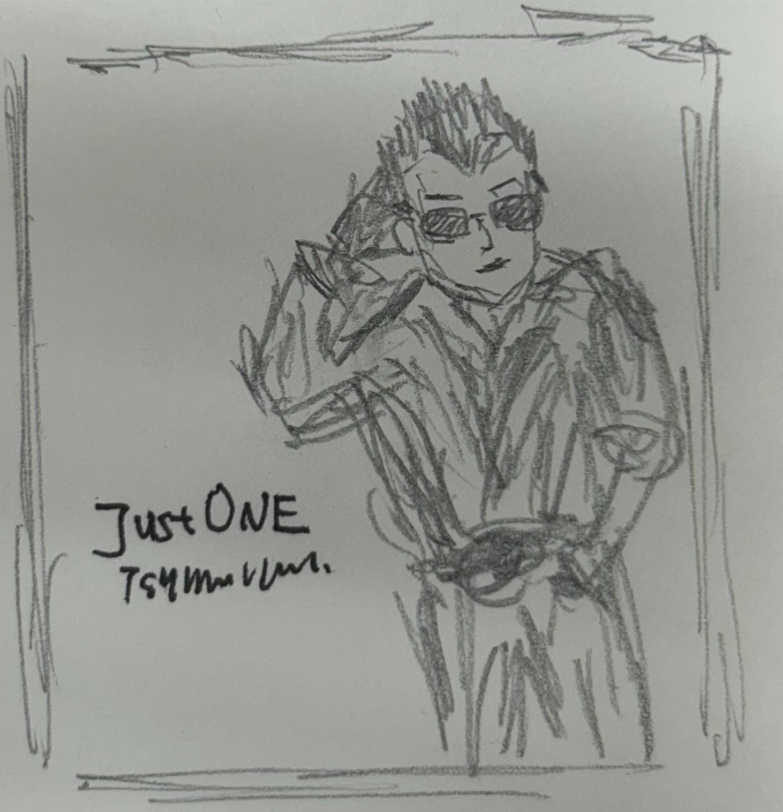

  
  

    

      推薦 長渕剛 的 とんぼ
       
      出自專輯 just one
       
      <a href="https://www.youtube.com/watch?v=MtqWkRWEe2c" target="_blank">收聽連結 -> 點此前往</a>
    

  

  

    
  

<!-- more -->
轉載自個人ig每日點播> chjuhsu05
 
我聽到的是後期重發的版本，但我個人喜歡1988年的唱法，最推薦的是1992 年東京巨蛋演唱會的版本，這首把繁華東京的「憧憬」和現實裡的「狼狽」反差表現的非常的真實，蜻蜓真的是一個精準的比喻，既脆弱又倔強。

非常推薦啊啊啊
