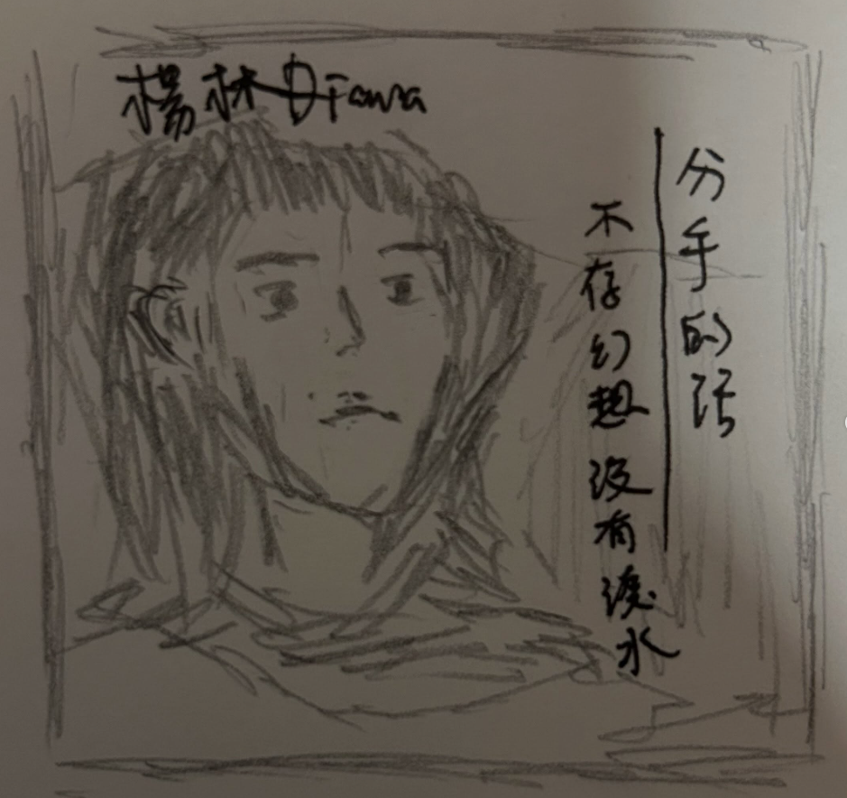

  

    

      推薦 楊林 的 分手的話
       
      出自同名專輯
       
      <a href="https://open.spotify.com/track/6NU6x0AdRnznBGFA0VQ7zA?si=82a238de400b44e7" target="_blank">收聽連結 -> 點此前往</a>
    

  

  

    
  

<!-- more -->
轉載自個人ig每日點播> chjuhsu05
 
這首歌有一種很鮮明的八〇年代流行歌曲氣息，簡單又帶點復古感的編曲，搭配楊林輕柔的歌聲，聽起來反而讓我覺得很新鮮。

明明已經是四十多年前的歌曲，聽著卻會突然覺得，原來人們面對分手時的心情，好像從以前到現在都沒有改變太多。明明還有感情，卻知道兩個人很難再繼續走下去。那些捨不得說出口的話，以及對未來無法給出的承諾，似乎不論在哪個年代都一樣讓人無奈。這首歌沒有過度渲染離別的悲傷，而是用一種輕柔又帶點青澀的方式，唱出這段不得不告別的感情。

或許時代一直在改變，但有些關於喜歡與離別的心情，真的沒有想像中那麼不同。

非常推薦啊啊啊
