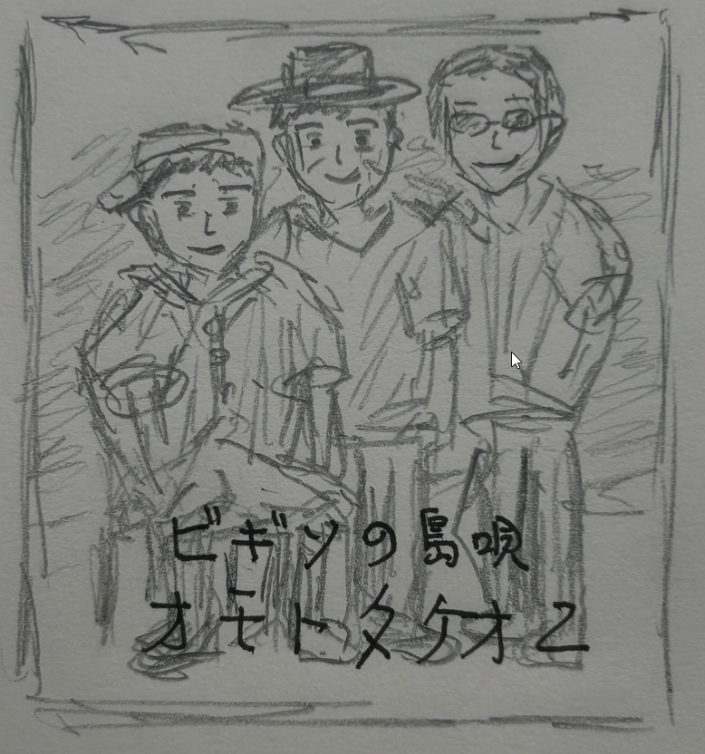

  
  

    

      推薦 BEGIN 的 島人ぬ宝
       
      出自專輯 ビギンの島唄 ～オモトタケオ2～
       
      <a href="https://open.spotify.com/track/5WgCHXvD4eJbDuIKDLMLFm?si=208e4574569b4f08" target="_blank">收聽連結 -> 點此前往</a>
    

  

  

    
  

<!-- more -->
轉載自個人ig每日點播> chjuhsu05
 
這首非常沖繩，就像是我在美國村海灘旁邊聽到的演奏，雖然也很喜歡夏川里美的翻唱版本，但 BEGIN 的原唱對我來說更特別！當前奏的三線琴聲一響，彷彿整個人就瞬間切換到了沖繩。搭配 BEGIN 質樸又充滿生活感的歌聲，那種自然、熱鬧又帶著人情味的氛圍，真的很吸引我。

有時候，明明是在這座島上長大的人，卻不一定真正了解故鄉的一切。不知道天空中每顆星星的名字，不知道如何阻止海洋環境惡化，甚至不完全明白傳統歌謠的意思，但這些東西仍然是自己無可取代的寶物，島民之寶，不只是島上的天空、大海與歌聲，而是這些事物陪伴人們生活，逐漸成為共同記憶與文化的一部分。真的即使還沒有完全理解它們，知道它們對自己有多麼重要這件事情完全不衝突，〈島人ぬ宝〉不只是懷舊，還有一份希望這些寶物能夠繼續存在的珍惜。

非常推薦啊啊啊
