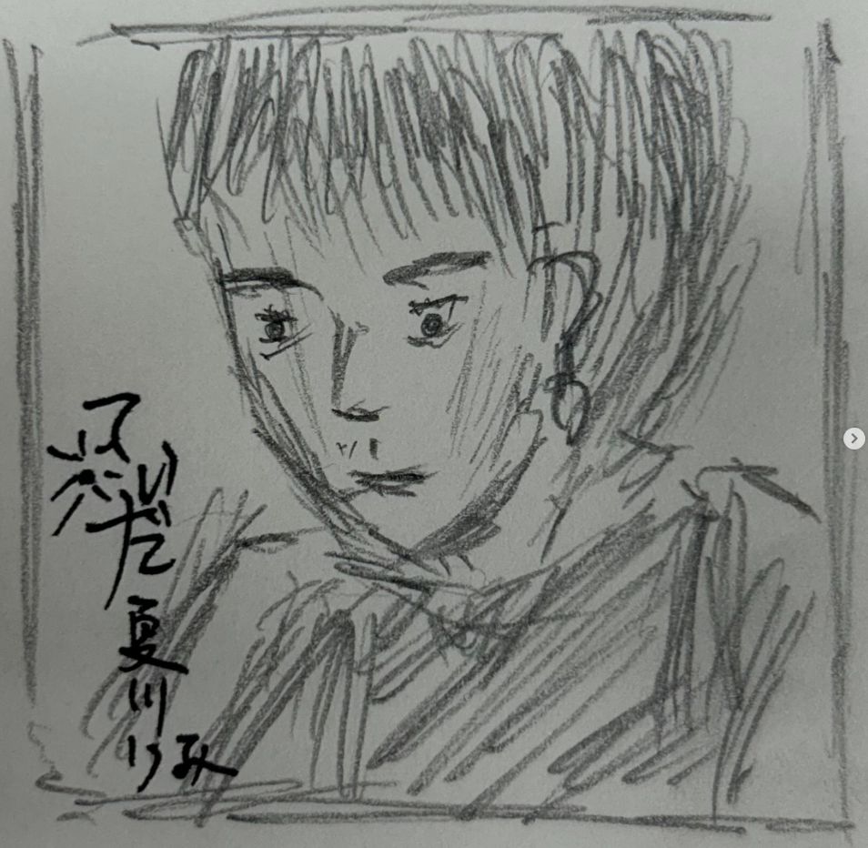

  
  

    

      推薦 夏川里美 的 島唄
       
      出自專輯 てぃだ ～太陽・風ぬ想い～
       
      <a href="https://open.spotify.com/track/3YLqM2BjxL3nQb8yV67spQ?si=b4ffa16c7c984199" target="_blank">收聽連結 -> 點此前往</a>
    

  

  

    
  

<!-- more -->
轉載自個人ig每日點播> chjuhsu05
 
這首歌是翻唱自the boom，因為去沖繩玩過我真的很能體會那種將最沉重的苦難，化為對風、花、海的詠唱的感覺，這次翻唱更將這種包容表達的更讓人內心複雜，尤其是這首歌融入我在沖繩海灘上聽到的三線琴，這首反戰歌曲對我來說非常特別。

非常推薦啊啊啊
