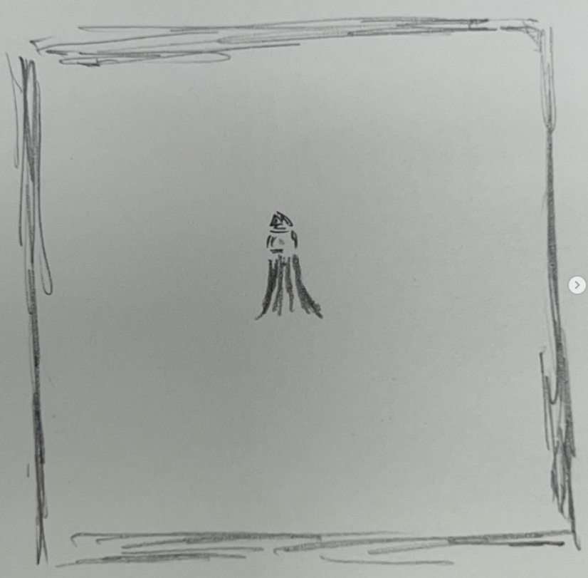

  
  

    

      推薦 宋德鶴 的 從沒來停過
       
      出自專輯 燈塔
       
      <a href="https://open.spotify.com/track/5mR5I4bKY6HlwrukCWekWE?si=e32972fe62014ff8" target="_blank">收聽連結 -> 點此前往</a>
    

  

  

    
  

<!-- more -->
轉載自個人ig每日點播> chjuhsu05
 
來自Anita的投稿，歌詞我其實還是沒到很懂(小抽象)，歌曲很有〈山海〉類似的張力，從壓抑到最後猛然爆發的特別聽感，焦躁跟宣洩也會跟著被傾倒出來一點點，但歌詞跟情緒真的好難接上。

非常推薦啊啊啊
