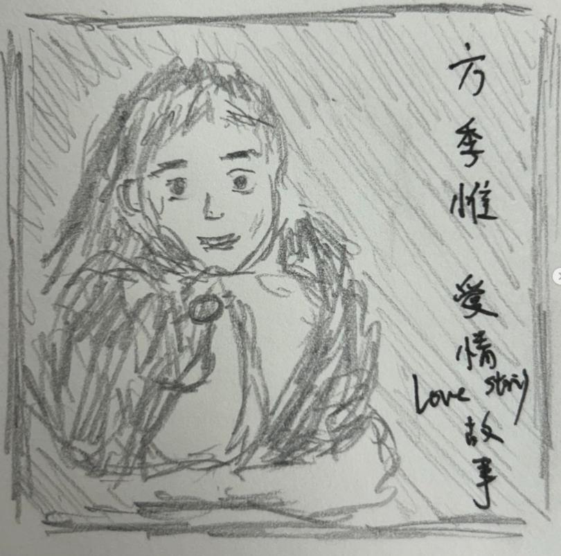

  
  

    

      推薦 方季惟 的 愛情的故事
       
      出自歌曲同名專輯
       
      <a href="https://open.spotify.com/track/5q9FLtKa6EtOVPLaRwH61E?si=2f85e3b77c1f468e" target="_blank">收聽連結 -> 點此前往</a>
    

  

  

    
  

<!-- more -->
轉載自個人ig每日點播> chjuhsu05
 
我很喜歡方季惟清亮的聲音，搭配九〇年代的編曲，整首歌有一種很舒服的律動。雖然歌詞其實沒有旋律聽起來那麼輕快。它描述的是愛情裡的沉默與等待，甚至是一段還來不及開始的感情。

非常推薦啊啊啊
