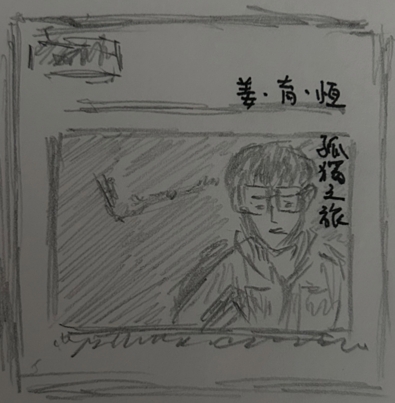

  

    

      推薦 姜育恆 的 愛我
       
      出自專輯 愛我.孤獨之旅
       
      <a href="https://open.spotify.com/track/4PBdOQwfwnrUcM5HMcoc0I?si=0b84b79367c64c1f" target="_blank">收聽連結 -> 點此前往</a>
    

  

  

    
  

<!-- more -->
轉載自個人ig每日點播> chjuhsu05
 
這次想推薦姜育恆，是因為他是我媽年輕時很喜歡的偶像！一直有點好奇，媽媽年輕的時候究竟喜歡聽什麼樣的音樂？那些曾經陪伴她的歌曲，又有著什麼樣的魅力？

〈愛我〉是姜育恆首張專輯裡的歌曲，帶著很鮮明的八〇年代華語流行音樂氣息。略帶沙啞又有點憂鬱的歌聲，搭配直白的情感表達，確實有一種很特別的味道。

比起這首歌在講什麼，我這次反而更想知道，當年的人們是怎麼聽這些歌曲的，又為什麼會喜歡上這樣的聲音。或許現在的我和媽媽喜歡的音樂不完全一樣，但能透過她曾經喜歡的歌手，稍微認識一下她年輕時的世界，也是一件很有趣的事情。

非常推薦啊啊啊
