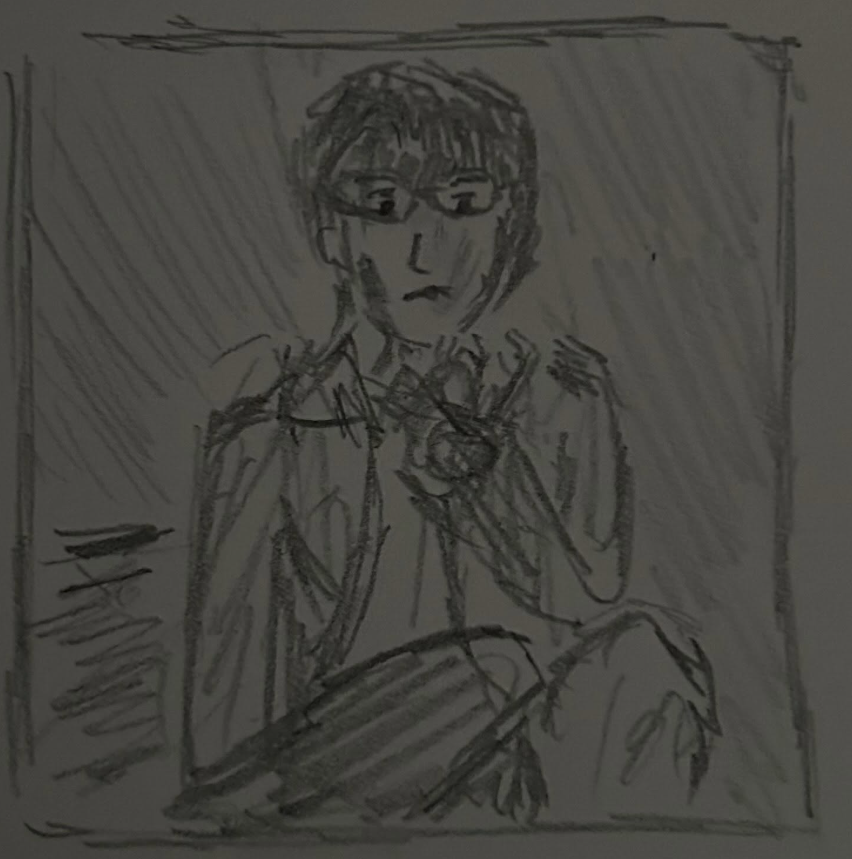

  
  

    

      推薦 許嵩和何曼婷 的 素顏
       
      出自同名單曲專輯
       
      <a href="https://open.spotify.com/track/65bRYkG90LpIzqLzg4firZ?si=1e77b55c5191460e" target="_blank">收聽連結 -> 點此前往</a>
    

  

  

    
  

<!-- more -->
轉載自個人ig每日點播> chjuhsu05
 
這首歌初聽會以為是在感嘆對方被時間改變、開始化妝，但我更喜歡它對那種「落差感」的坦然。其實沒有人能完全不變，所謂的「素顏」更像是一個被時光包裝與定格的過去。這首歌寫「喜歡」的角度特別有趣，它不是執著於現在（或未來）要擁有對方，而是把喜歡退回成一種溫柔的見證——承認彼此的生活圈已經錯位，也不去勉強磨合，而是打從心底欣喜於我們曾共享過那段未經雕琢的純粹，這種對感情轉變的釋懷對我來說非常特別，尤其是雙人演唱的互虧感很特別。

非常推薦啊啊啊
