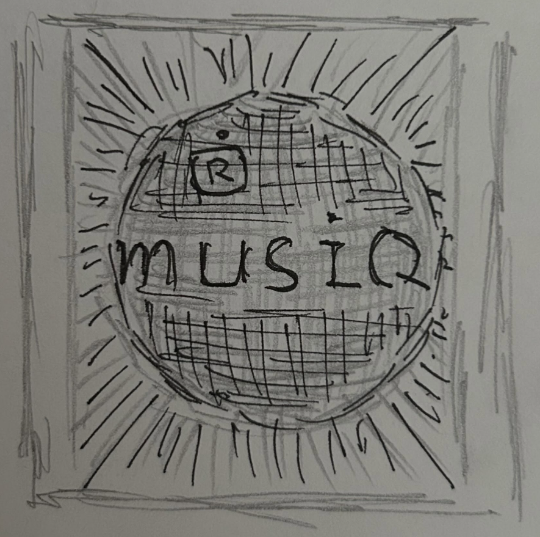

  
  

    

      推薦 Orange range 的 花
       
      出自專輯 musiQ
       
      <a href="https://open.spotify.com/track/5h5ACEliQ9toZ3fJwVc09f?si=5893bf88494d4ad5" target="_blank">收聽連結 -> 點此前往</a>
    

  

  

    
  

<!-- more -->
轉載自個人ig每日點播> chjuhsu05
 
這首歌雖然通篇只專注於描寫「相遇」與「感謝相遇」這件單純的事，卻能寫得如此純粹又特別好聽。沒有刻意雕琢的華麗辭藻，而是藉由三人聲線的交錯推進與直擊人心的旋律，把最樸素的謝意唱得層次分明又極具感染力。將彼此的相逢化作花朵綻放的意象，那種打從心底珍惜眼前每一刻的真摯與暖意，每一次重聽依然深深打動我。

非常推薦啊啊啊
