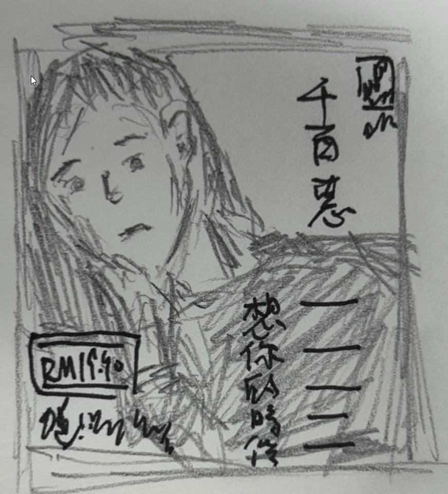

  
  

    

      推薦 千百惠 的 走過咖啡屋
       
      出自專輯 想你的時候
       
      <a href="https://open.spotify.com/track/47sL88KSkmTAuH8xShBFBj?si=264bf75a41a246c5" target="_blank">收聽連結 -> 點此前往</a>
    

  

  

    
  

<!-- more -->
轉載自個人ig每日點播> chjuhsu05
 
這首我反覆聽了很久，八〇年代特有的復古電子編曲跳躍明快卻搭配「物是人非」的惆悵，帶來一種「腳步很輕、心事很深」的反差，明明是懷念，但歌手卻唱出一種那個年代獨有的摩登與灑脫。

非常推薦啊啊啊
