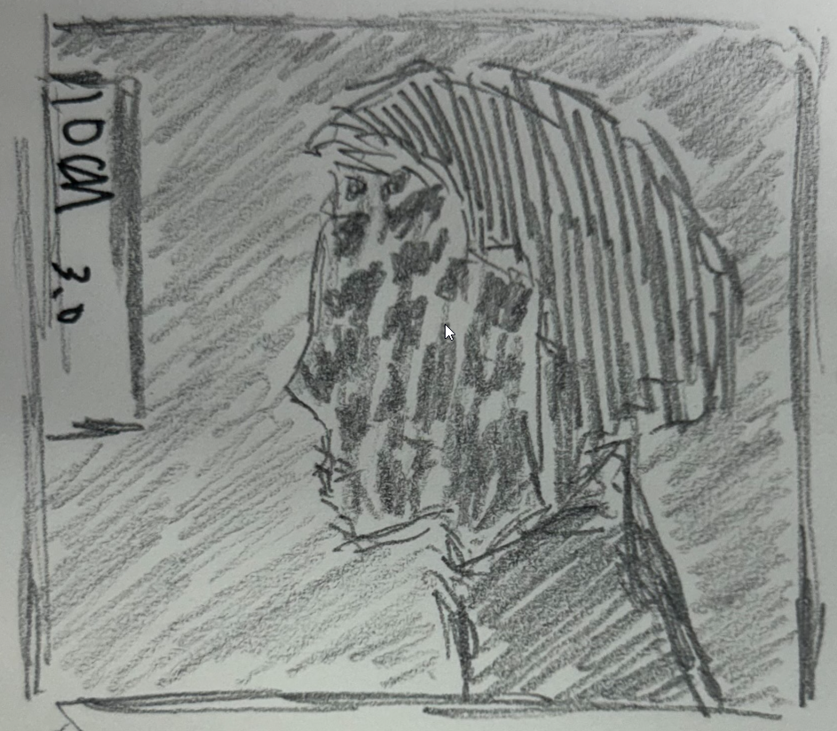

  
  

    

      推薦 10cm 的 스토커（Stalker）
       
      出自專輯 3.0
       
      <a href="https://open.spotify.com/track/5FWMv2Kor3Rl9MoM9Ei0vz?si=429c342ad7ed4afe" target="_blank">收聽連結 -> 點此前往</a>
    

  

  

    
  

<!-- more -->
轉載自個人ig每日點播> chjuhsu05
 
這首除了好聽之外，非常精準捕捉了自覺配不上對方的卑微。看著閃閃發亮的對方，卻怕自己的視線都成了她的負擔。暗戀裡最狼狽、自我懷疑的一面真實得讓人無法抵抗，「喜歡著閃耀的某人這回事...如果是有標準...因為我是個戴眼鏡的呆子啊」

非常推薦啊啊啊
