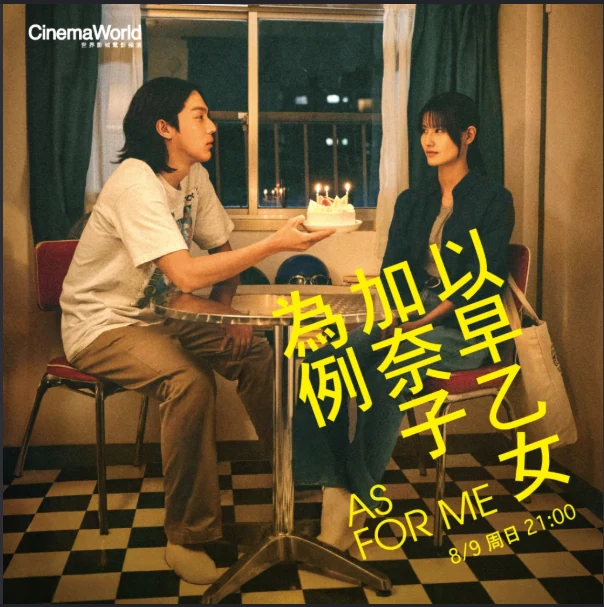

《以早乙女佳奈子為例》這部電影對我來說非常特別，像是畫一樣只給我影像但沒有留給我劇情！

<!-- more -->

## 觀影歷程

這部是我偶然間在FRIDAY影音上面看到的，被劇情之外的顏色與封面吸引，對我來說這個類型的電影是我比較少會看到。整個電影的故事不是不存在，只是它好像沒有一直要求觀眾注意接下來會發生什麼。比起故事本身，反而電影的呈現更容易記得人物站在哪裡、窗外的光、衣服和街景的顏色，以及整部電影始終維持著的某種輕盈感。有一點像看完一幅畫。你未必能立刻說出畫裡每一個細節代表什麼，可是它的色彩與感覺會先留下來。

看完之後過了一天，我發現很多情節已經開始變得零碎，但那種零碎並沒有讓電影完全消失。它反而像是留下一些抓不住的片段，偶爾從記憶裡浮出來，提醒我曾經看過這樣早乙女佳奈子的生活，以及她在一些關係裡做出的選擇，而且默默陪他走了好幾年。

> 畫廊的感覺可以參考[這篇部落格文章](https://ameblo.jp/69207080/entry-12885336891.html)，裡面有不少劇照。

## 劇情特色

《以早乙女佳奈子為例》的故事不算複雜。大學入學時，早乙女加入演劇社團，認識了想成為劇作家的長津田。兩人的關係從一支舞開始，很快地交往，也就這樣一起度過了學生時代，接著出了社會。

電影沒有花很多時間解釋兩個人為什麼喜歡上彼此(或是電影把這份喜歡保留給觀眾去猜)，用一連串很快的生活片段帶過，例如一起吃東西、聊天、跳舞(這點以電影來說很特別)，很多小事情甚至還沒有來得及停留，畫面就已經往下一個時間點走。在這些被快速帶過的片段裡，我們很自然地融入到兩個人已經建立起來的親密互動中，但隱隱刺痛人的事兩個人的前進速度並不相同，尤其是電影其中一幕對戒的隱喻，窗外這件事情精緻又心痛。

> *可惜找不到這張照片，這張是我個人非常欣賞的劇照

有趣的是電影沒有特別去呈現這份衝突，反而透過快節奏的加入更多人物讓關係開始出現其他可能，大家各自向不同的人和不同的生活靠近，卻又始終沒有完全從彼此的人生裡消失，對於我們觀眾來說，無論你是女主角角度的糾結，例如要不要繼續一段關係、要不要往前走、要不要接受另一個人，又或者當曾經離開的人重新出現在眼前時，自己現在究竟想要的是什麼？

甚至你可以說沒有哪一次分開像世界末日，也沒有哪一次重逢像命中注定。

很多重要的變化，就跟電影前面那些生活片段一樣，很快地發生，然後人物繼續生活。

> *電影並沒有把這些選擇拍成很戲劇化的轉折。

這些處理方式讓整部電影有一種很特別的輕盈感(即使故事整整經過了十年的時間軸)。
戀愛、分手、工作、錯過與重逢都發生過，卻很少有一件事情被刻意放大。故事一直往前走，人物也一直做著選擇...

> *那些沒有答案的瞬間或是留白不知道是不是打開電影的另外一種方式？

## 我的感想

這部電影對我來說很困難，有時候感覺不到重量，但它其實該發生的事情其實都發生了。
有時候很像是紀錄片的手法，電影很少刻意把某一件事拉出來，告訴觀眾「這就是最重要的時刻」。很多事情只是發生，然後過去。

> 整部電影始終有一種很輕的感覺。

它很少讓情緒停留太久。即使人物正在經歷一些照理說應該很沉重的事情。所以回頭想這部電影時，我最先留下來的反而不一定是劇情，而是它的顏色。一些光線、衣服、街道、房間，以及人物站在畫面裡的樣子。

> 通常看完電影以後，我會先想到某一段劇情、某一個角色，或是某一句話

還有一點是，除了女主角之外，其他角色也都有一些讓我印象很好的瞬間。很多人在剛出場的時候，即使只有很短的篇幅，也會有一點屬於自己的特色(或說是個性鮮明)。這邊的鮮明我覺得特別在這是一種跟別人相處的方式。可是那些人又很快離開了。鏡頭始終主要跟著女主角，所以其他人的生活大多只在與她交會的地方被看見。原本很鮮明的人，離開她的視線之後，也就慢慢退到故事之外。

> 但說不定，這或許正是電影能維持這種輕盈感的原因

如果每一個人物都被好好交代，每一段關係都得到完整的解釋，每一次離開都要得到一個結論，這部電影大概就不會是現在這個樣子了。
反而是很多東西都只停留了一下。出現、被介紹，然後離開，很多事情沒有真正被留下。人物抓不住，關係抓不住，甚至連一段情緒都還沒有完全沉下來，電影就已經往下一個地方繼續前進。大概只有電影一開始的對戒與那個窗外的暗諭吧！隔著玻璃，可以看到外面的東西，可是真正伸出手時，又什麼也碰不到。我不知道這是不是電影刻意安排的象徵，但它很接近我看完整部電影以後的感覺。電影大部分時間都容許這些關係停留在一種沒有完全整理好的狀態。它沒有留下一個很強烈的故事，也沒有給我一個非得記住的答案。反而最後留下來的是一些顏色、一些被介紹過的場景，以及一種伸手想抓，卻沒有真正抓住什麼的感覺。

## 小小總結

我現在幾乎只能記得一些光、顏色，以及幾個人站在畫面裡的樣子。它沒有哪一句話讓我覺得自己突然理解了人生或愛情，可是這種淡到好像伸手就會消失，卻又沒有真的消失的顏色感很特別，也不是每一部電影都要有答案或是收穫吧？

硬要說的話這次顏色在調色盤上點了半天卻不知道怎樣選，可能就是早乙女那些猶豫的感覺？

燃燒過與希望對方安好的喜歡 

VS 

渴望被保護以及期待被欣賞的欣喜 

卻又再次 VS 

自己(對自己究竟想怎麼生活這個概念確實也存在)

真正困難的從來不是在兩個人之間選出一個答案，而是這幾種顏色混在一起之後，連她自己都很難立刻說清楚，最後想留下的是哪一種。

*(圖片來源：民視新聞)*
